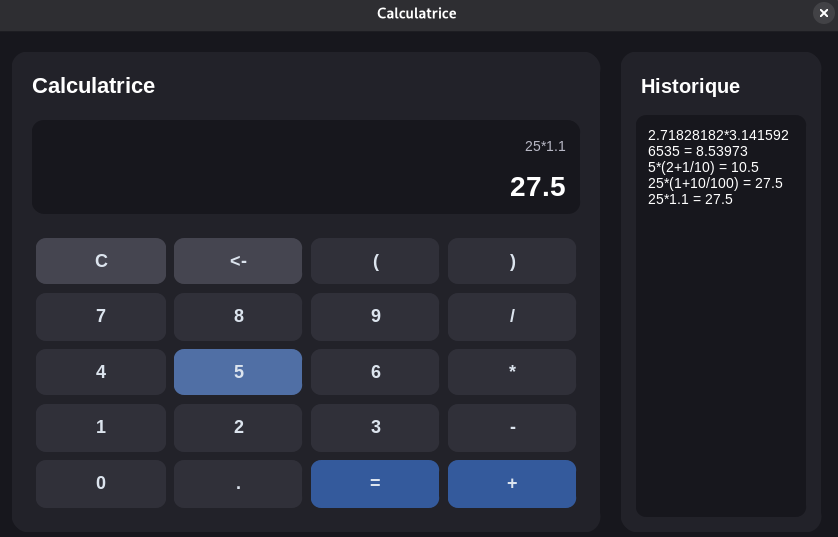

# Python Calculator

Projet personnel réalisé en Python pour pratiquer et approfondir les concepts de POO.

Le projet a évolué progressivement : d'une calculatrice en console vers une application graphique capable d'analyser des expressions mathématiques, de respecter les priorités opératoires et de conserver un historique des calculs.

L'objectif principal est l'apprentissage : comprendre les choix de conception, améliorer la qualité du code et gagner progressivement en autonomie.

## Objectifs

Ce projet permet de travailler notamment sur :

- Programmation orientée objet (POO)
- Héritage et polymorphisme
- Pattern Factory
- Séparation des responsabilités
- Exceptions personnalisées
- Analyse et parsing d'expressions mathématiques
- Priorités
- Interface graphique avec CustomTkinter
- Gestion d'un historique des calculs
- Tests unitaires avec `pytest`
- Gestion des erreurs et validation des expressions

## Versions

### V1 — Calculatrice console

Première version consacrée à la logique métier et aux bases de la programmation orientée objet.

Fonctionnalités :

- Addition
- Soustraction
- Multiplication
- Division
- Gestion des erreurs de calcul
- Exceptions personnalisées
- Création des opérations avec le pattern Factory
- Exécution de plusieurs calculs successifs
- Interface en ligne de commande

Exemples :

```text
Calcul : 5 + 7
Résultat : 12

Calcul : 10 / 2
Résultat : 5

Calcul : 25 * 4
Résultat : 100
```

### V2 — Interface graphique

Création d'une interface graphique avec CustomTkinter afin d'utiliser la calculatrice sans passer directement par le terminal.

Fonctionnalités :

- Interface graphique personnalisée
- Boutons numériques et opérateurs
- Affichage de l'expression saisie
- Affichage du résultat
- Effacement complet et suppression du dernier caractère
- Gestion des erreurs dans l'interface
- Historique des calculs réussis
- Possibilité de poursuivre un calcul à partir du résultat précédent
> PS : Pour le calcul, j'ai utilisé **eval()**. Pour la prochaine version, un système d'analyse syntaxique (**parser**) complet sera implémenté.

### V3 — Analyse des expressions mathématiques

Ajout d'un parseur permettant de saisir des expressions plus complètes, sans limiter chaque calcul à deux nombres et un opérateur.

Exemples :

```text
5 + 7 * 2
(5 + 7) * 2
10 / 2 + 3
```

Le parseur analyse l'expression et respecte les priorités opératoires, notamment :

- Les parenthèses
- La multiplication et la division avant l'addition et la soustraction
- L'évaluation des opérations dans le bon ordre

Cette partie utilise un `ExpressionParser` dédié, qui s'appuie sur les services et les classes d'opérations du projet.

**Remarque :** le parseur a été développé avec l'aide de l'IA. Son fonctionnement général est compris, mais certains détails de son implémentation restent à approfondir dans le cadre de ma compréhension.

## Architecture

Le projet sépare l'interface graphique, l'analyse des expressions, les opérations mathématiques et les services métier.

```text
calculatrice/
│
├── main.py
│
├── img/
│   └── exemple
│
├── src/
│   ├── operations/
│   │   ├── operation.py
│   │   ├── addition.py
│   │   ├── soustraction.py
│   │   ├── multiplication.py
│   │   └── division.py
│   │
│   ├── exceptions/
│   │   ├── calculator_exception.py
│   │   ├── division_by_zero.py
│   │   └── invalid_operation.py
│   │
│   ├── services/
│   │   ├── calculator.py
│   │   ├── expression_parser.py
│   │   └── operation_factory.py
│   │
│   └── ui/
│       └── calculator_window.py
│
└── tests/
    ├── test_operations.py
    ├── test_calculator.py
    └── test_history.py
```

*Cette arborescence représente l'organisation cible : les fichiers affichés doivent correspondre aux fichiers réellement présents dans le dépôt.*

### Rôle des principaux composants

- **`main.py`** : point d'entrée de l'application graphique.
- **`CalculatorWindow`** : gère l'interface graphique et les interactions de l'utilisateur.
- **`ExpressionParser`** : analyse les expressions, identifie les opérateurs et organise leur évaluation en respectant les priorités opératoires.
- **`OperationFactory`** : crée l'opération correspondant à un opérateur donné.
- **`Calculator`** : exécute une opération.
- **`Operation`** : définit l'interface commune aux différentes opérations mathématiques.
- **`CalculatorException`** : fournit une classe de base pour les exceptions personnalisées.

## Fonctionnement général

```text
Utilisateur
    |
    v
main.py
    |
    v
CalculatorWindow
    |
    v
ExpressionParser
    |
    v
OperationFactory
    |
    v
Opération concrète
    |
    v
Calculator
    |
    v
Résultat
    |
    v
Affichage et historique
```

L'interface transmet l'expression au parseur. Celui-ci analyse les éléments et détermine l'ordre d'exécution des opérations. La Factory crée les objets nécessaires, puis le calculateur exécute les opérations et le résultat est renvoyé à l'interface.

## Concepts de programmation orientée objet

Les différentes opérations héritent d'une classe commune :

```text
             Operation
                 |
       +---------+---------+
       |         |         |
   Addition  Multiplication Division
```

Cette conception permet d'utiliser le polymorphisme : le calculateur peut travailler avec différentes opérations à travers une interface commune, sans devoir connaître leur implémentation concrète.

Les exceptions personnalisées permettent également de distinguer les erreurs propres à l'application des erreurs générales de Python.

## Choix techniques

### Pourquoi un parseur ?

L'utilisation de `eval()` a été envisagée au départ pour évaluer directement les expressions. Cependant, cette approche ne permettait pas de réutiliser naturellement les classes d'opérations et la Factory du projet. Aussi question de sécuriter, il n'est pas conseillé d'utiliser eval().

Un parseur dédié permet de contrôler l'analyse de l'expression et de conserver l'architecture orientée objet.

Il constitue également une occasion d'approfondir des notions importantes : tokenisation, grammaire, récursivité et priorités opératoires.

### Pourquoi ne pas utiliser de threads ?

L'utilisation de threads et de mécanismes de synchronisation a été envisagée pendant la conception du projet, mais elle a finalement été écartée(flemme).
J'avais un DS sur la POO et Threads, j'ai donc voulu me consentré sur la POO.

Le projet privilégie donc une architecture simple, adaptée au besoin réel.

## Installation et lancement

Depuis la racine du projet, activer l'environnement virtuel :

```bash
source .venv/bin/activate
```

Installer les dépendances nécessaires si elles ne sont pas déjà présentes :

```bash
pip install customtkinter pytest
```

Lancer l'application graphique :

```bash
python main.py
```
## Compilation en exécutable

Il est possible de compiler la calculatrice en un exécutable Windows (`.exe`) à l'aide de [PyInstaller](https://pyinstaller.org/).

### Installation

```bash
pip install pyinstaller
```

### Génération de l'exécutable

Depuis la racine du projet, exécuter :

```bash
pyinstaller --noconfirm --clean --windowed --onefile --name "FakeQuantumCalculator" --icon "img/FakeQuantumCalculator.ico" main.py
```

Depuis la racine du projet,  pour lancer la calculatrice :

```bash
chmod +x /dist/FakeQuantumCalculator
 ./dist/FakeQuantumCalculator
```

- `--onefile` : génère un exécutable unique.
- `--windowed` : évite l'ouverture d'une console supplémentaire.
- `--name` : définit le nom de l'exécutable.
- `--icon` : définit l'icône de l'application.

L'exécutable généré sera disponible dans le dossier `dist/`.

**Remarque :** la compilation pour Windows doit être réalisée sous Windows. Le fichier `.ico` doit exister au chemin indiqué. Il est également recommandé de tester l'exécutable sur une machine où Python n'est pas installé.

## Aperçu de l'application

Voici un aperçu de l'interface graphique de la calculatrice, développée avec Python et CustomTkinter.



La capture présente l'interface de calcul, les boutons numériques et opérateurs ainsi que l'historique des calculs.


## Tests

Ils permettent de vérifier le comportement des opérations, du calculateur et de l'historique.

Les tests du parseur peuvent notamment couvrir :

- Les expressions simples
- Les priorités opératoires
- Les parenthèses
- Les expressions mal formées
- La division par zéro
- Les opérateurs non pris en charge

## Démarche de développement

Ce projet est avant tout un projet d'apprentissage personnel.

La majorité du code a été écrite par moi-même, notamment les opérations mathématiques, les exceptions personnalisées, les services métier et le point d'entrée de l'application.

L'interface graphique a également été développée majoritairement par moi-même.

Le parseur d'expressions a, quant à lui, été réalisé avec une aide importante de l'IA. Son fonctionnement général est compris, mais sa logique interne reste un axe de progression : l'objectif est de pouvoir progressivement l'expliquer, le tester et le faire évoluer de manière autonome.

L'utilisation de l'IA fait partie de la démarche, mais elle ne remplace pas l'objectif principal : comprendre le code et progresser en programmation.
Il ne s'agit donc pas de vibe coding. Ce projet m'a demandé 25 heures de travail et de développement, et 80 % du code a été écrit par moi-même.

## Améliorations réalisées et pistes d'évolution

- [x] Créer les opérations mathématiques
- [x] Mettre en place la programmation orientée objet
- [x] Implémenter le pattern Factory
- [x] Créer des exceptions personnalisées
- [x] Développer la version console
- [x] Créer une interface graphique avec CustomTkinter
- [x] Ajouter un historique dans l'interface
- [x] Intégrer un parseur d'expressions
- [x] Prendre en compte les priorités opératoires
- [ ] Approfondir et maîtriser le fonctionnement interne du parseur
- [ ] Renforcer les tests unitaires du parseur
- [ ] Améliorer la validation des expressions et des cas limites
- [ ] Vérifier la cohérence entre les différentes couches applicative

---

Projet personnel réalisé en Python dans une démarche d'apprentissage continu.